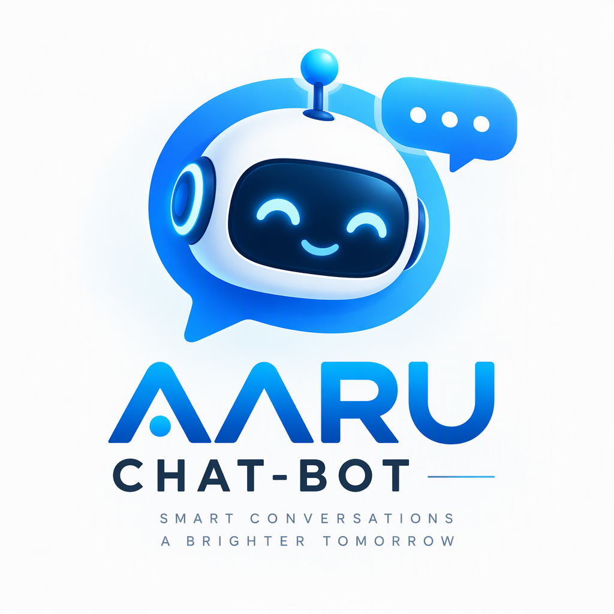

<div align="center">



# AARU CHAT-BOT

### AI Chatbot Template — Built with Next.js and the AI SDK

[](LICENSE)
[]()
[]()
[](https://vercel.com/templates/next.js/chatbot)

**Made by [AARUTO](https://github.com/AARUTO347)**

[Features](#-features) • [Quick Start](#-quick-start) • [Deploy](#-deploy) • [Configuration](#-configuration)

</div>

---

## About

AARU Chatbot is a free, open-source chatbot template built with **Next.js** and the **Vercel AI SDK**. Ship a production-ready AI chatbot in minutes — not months.

## Features

### Framework & Architecture

- **Next.js 15** App Router
  - Advanced routing for seamless navigation
  - React Server Components (RSCs) for server-side rendering
  - Server Actions for mutations
- **TypeScript** — Full type safety

### AI Integration

- **Vercel AI SDK** — Unified API for text generation, structured objects, and tool calls
- **Multiple Model Providers:**
  - OpenAI (GPT-4, GPT-3.5)
  - Anthropic (Claude)
  - Google (Gemini)
  - xAI (Grok)
  - Mistral
  - Moonshot
  - DeepSeek
  - Ollama (local)
- **Dynamic Provider Detection** — Models auto-configure based on available API keys
- **AI Gateway** — Route through Vercel AI Gateway for unified access

### UI & Styling

- **shadcn/ui** — Beautiful, accessible component primitives
- **Tailwind CSS** — Utility-first styling
- **Radix UI** — Unstyled, accessible React components
- **Generative UI** — Dynamic interfaces from AI responses

### Data & Auth

- **Neon Serverless Postgres** — Chat history and user data
- **Vercel Blob** — Efficient file storage
- **Auth.js** — Simple and secure authentication
- **File Upload** — Share images and documents in chat

## Quick Start

### Prerequisites

- Node.js 18+
- pnpm (recommended) or npm/yarn
- Vercel account (for deployment)

### Installation

```bash
# Install Vercel CLI
npm i -g vercel

# Clone and setup
git clone https://github.com/AARUTO347/AARU_CHAT-BOT.git
cd AARU_CHAT-BOT

# Link to Vercel (creates .vercel directory)
vercel link

# Pull environment variables
vercel env pull

# Install dependencies
pnpm install

# Setup database
pnpm db:migrate

# Start development server
pnpm dev
```

Visit [http://localhost:3000](http://localhost:3000)

### Environment Variables

```bash
# .env.local — AI Provider Keys (at least one required)
OPENAI_API_KEY=your_openai_key
ANTHROPIC_API_KEY=your_anthropic_key
GOOGLE_API_KEY=your_google_key

# AI Gateway (for non-Vercel deployments)
AI_GATEWAY_API_KEY=your_gateway_key

# Database
DATABASE_URL=your_postgres_url

# Auth
AUTH_SECRET=your_auth_secret

# Storage
BLOB_READ_WRITE_TOKEN=your_blob_token
```

> **Security:** Never commit your `.env` file. Use [Vercel Environment Variables](https://vercel.com/docs/projects/environment-variables) for production.

## Deploy

### Vercel (Recommended)

[](https://vercel.com/templates/next.js/chatbot)

One-click deployment with automatic environment configuration.

### Manual Deployment

```bash
vercel --prod
```

## Configuration

### Model Setup

Models are configured in `lib/ai/models.ts` with per-model provider routing. Edit this file to:

- Add/remove available models
- Change default model
- Configure provider-specific options
- Set token limits

### AI Gateway

**Vercel deployments:** Authentication is handled automatically via OIDC tokens.

**Non-Vercel deployments:** Provide an AI Gateway API key via `AI_GATEWAY_API_KEY` environment variable.

### Database

The template uses **Neon Serverless Postgres** for:
- Chat history persistence
- User data storage
- Session management

Run migrations after setup:

```bash
pnpm db:migrate
```

## Tech Stack

| Layer | Technology |
|-------|-----------|
| Framework | Next.js 15 (App Router) |
| Language | TypeScript |
| AI | Vercel AI SDK |
| UI | shadcn/ui + Tailwind CSS + Radix UI |
| Database | Neon Serverless Postgres |
| Storage | Vercel Blob |
| Auth | Auth.js |
| Deployment | Vercel |

## Project Structure

```
AARU_CHAT-BOT/
├── app/                  # Next.js App Router
│   ├── (chat)/          # Chat routes
│   └── api/             # API routes
├── components/          # React components
│   ├── ui/             # shadcn/ui primitives
│   └── chat/           # Chat-specific components
├── lib/
│   ├── ai/             # AI SDK configuration
│   │   └── models.ts   # Model provider setup
│   ├── db/             # Database utilities
│   └── auth/           # Authentication
├── public/             # Static assets
└── docs/               # Documentation
```

## Documentation

| Resource | Link |
|----------|------|
| Vercel AI SDK | [ai-sdk.dev](https://ai-sdk.dev/docs/introduction) |
| Next.js | [nextjs.org/docs](https://nextjs.org/docs) |
| shadcn/ui | [ui.shadcn.com](https://ui.shadcn.com) |
| Auth.js | [authjs.dev](https://authjs.dev) |
| Neon | [neon.tech/docs](https://neon.tech/docs) |

## Contributing

Contributions are welcome! Please open an issue or submit a pull request.

## License

**MIT** — see [LICENSE](LICENSE).

---

<div align="center">

**AARU Chatbot** — Made by [AARUTO](https://github.com/AARUTO347)

[GitHub](https://github.com/AARUTO347/AARU_CHAT-BOT) • [Deploy](https://vercel.com/templates/next.js/chatbot) • [Issues](https://github.com/AARUTO347/AARU_CHAT-BOT/issues)

</div>
